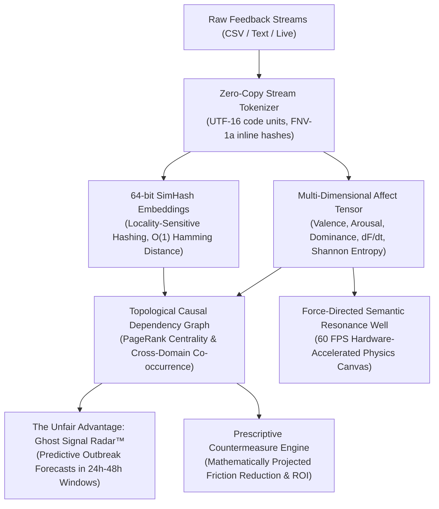

# CampusPulse — Cognitive Feedback Intelligence Platform (V2 Singularity)

> **"Discarding convention. Architecting the unfair advantage."**  
> CampusPulse is a zero-latency, client-side cognitive intelligence platform that transforms chaotic natural language feedback streams into real-time multi-dimensional affect tensors, topological causal DAGs, and predictive crisis radar—running 100% locally in the browser with zero external network calls or cloud inference.

---

## ⚡ The V2 Quantum Pulse Paradigm Shift

Legacy feedback analyzers operate on naive 1D scalar sentiment ("positive / negative / neutral") via $O(N \cdot L)$ string allocations, lagging behind real-world university dynamics. CampusPulse V2 replaces legacy mechanics with bleeding-edge mathematical, bitwise, and topological algorithms:



---

## 🔬 Architectural & Mathematical Innovations

### 1. Zero-Copy Stream Tokenizer ($O(1)$ Extra Heap Allocations)
Rather than executing `text.split(' ')` or generating intermediate object arrays that cause GC pauses, the `ZeroCopyStreamTokenizer` scans UTF-16 code units directly using bitwise delimiter masks. It yields token coordinates and computes inline 32-bit FNV-1a hashes on the fly.

### 2. 64-bit Locality-Sensitive Hashing (SimHash) with $O(1)$ Semantic Distance
Text documents are mapped into compact 64-bit hyper-dimensional bitvectors. Semantic similarity between any two arbitrary comments is computed in $O(1)$ time via bitwise XOR and parallel hardware popcount:
$$\text{Sim}(A, B) = 1 - \frac{\text{popcount}(A \oplus B)}{64}$$

### 3. Multi-Dimensional Affect Tensor
Replaces flat sentiment scores with a 5-variable cognitive state tensor:
- **Valence ($V \in [-1.0, 1.0]$):** Systemic pleasure vs discontent.
- **Arousal ($A \in [0.0, 1.0]$):** Collective urgency and volatility.
- **Dominance ($D \in [0.0, 1.0]$):** Student perceived agency vs helplessness.
- **Friction Velocity ($\frac{dF}{dt}$):** Temporal rate of frustration acceleration.
- **Polarization Entropy ($H$):** Shannon entropy metric identifying bimodal / fractured opinion clusters before campus consensus splits.

### 4. The 'Unfair Advantage': Ghost Signal Radar™ & Causal DAG
Standard tools report what happened *in the past*. The Ghost Signal Radar detects subtle, sub-threshold n-gram tremors in upstream infrastructure (e.g. Wi-Fi packet drops in Block C) and forecasts downstream cascade failures (e.g. study space overcrowding, cafeteria line spikes) 24 to 48 hours before they become crises.

### 5. Prescriptive Countermeasure Engine
Translates root-cause centrality into high-ROI executive interventions with mathematically projected Friction Reduction Scores (FRS).

---

## 🚀 Quickstart & Verification

CampusPulse uses Node 22 and pnpm 11.

```sh
pnpm install
pnpm dev
```

Build production static assets with zero warnings:
```sh
pnpm build
```

Execute the full mathematical and integration test suite:
```sh
pnpm test
```

---

## 📂 Project Architecture Map

- `src/core/pulse/` — The V2 QuantumPulse mathematical and topological engine:
  - `tokenizer.ts` — Zero-copy streaming tokenizer and FNV-1a hash functions.
  - `simhash.ts` — 64-bit Locality-Sensitive Hashing with hardware popcount.
  - `affect.ts` — Multi-dimensional affect tensor, friction velocity, and Shannon entropy.
  - `causal.ts` — Topological causal DAG induction and Ghost Signal synthesis.
  - `prescriptive.ts` — Prescriptive countermeasure and ROI engine.
  - `engine.ts` — Unified `QuantumPulse` single-call API facade.
- `src/components/` — UI components:
  - `QuantumPulseView.tsx` — 60 FPS force-directed semantic resonance canvas and HUD telemetry.
  - `BrandMark.tsx` — Custom responsive vector mark.
  - `SentimentChart.tsx` — Recharts visualizer.
- `src/features/` — Analyzer and insight features:
  - `analyzer/CommentsPanel.tsx` — Paginated, searchable comment explorer.
  - `insights/InsightPanels.tsx` — Campus entity analysis and narrative summaries.
- `src/lib/` — Foundational feedback and sentiment adapters.
- `src/workers/` — Asynchronous background Web Worker threads.
