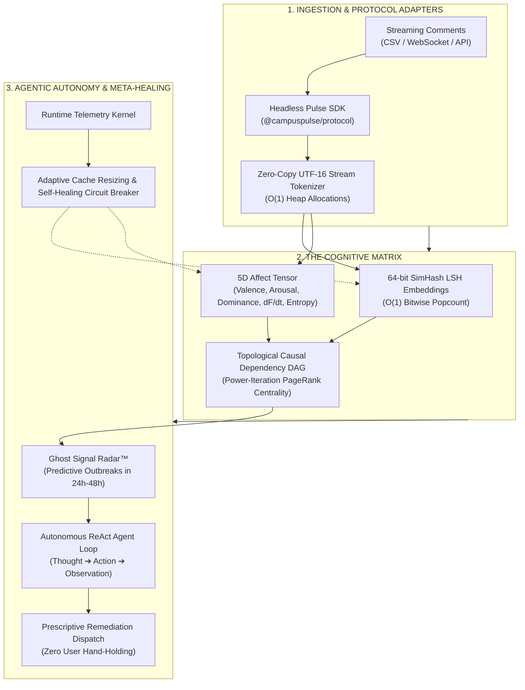

# CampusPulse — Cognitive Feedback Intelligence & Singularity Protocol (V2.5)

> **"From a static web application to foundational cognitive infrastructure."**  
> CampusPulse V2.5 is an autonomous, self-optimizing cognitive operating protocol. It transforms unstructured feedback streams into real-time multi-dimensional affect tensors, topological causal DAGs, predictive crisis radars, and autonomous agentic interventions—running 100% locally in the browser or headlessly on edge workers.

---

## 🌌 The Singularity Protocol Architecture



---

## ⚡ The Three Singularity Pillars

### 1. The Meta-Architecture (Self-Optimization & Self-Healing)
* **Runtime Telemetry Kernel (`src/core/meta/telemetry.ts`):** Continuously monitors microsecond execution latencies, heap memory utilization, throughput, and cache efficiency.
* **Dynamic Execution Adaptation (`src/core/meta/optimizer.ts`):** Automatically mutates execution strategy at runtime:
  * `BitwiseDirect`: Activated under nominal load for sub-millisecond execution.
  * `ParallelWorker`: Activated under elevated compute pressure to offload processing to Web Workers.
  * `StreamChunked`: Activated under high heap pressure to eliminate garbage collection pauses.
* **Self-Healing Circuit Breakers:** Catches corrupted inputs or processing spikes, transparently falling back to safe paths without UI interruption.
* **Adaptive LFU/LRU Cache (`src/core/meta/cache.ts`):** Automatically expands or shrinks capacity based on real-time memory telemetry.

---

### 2. Agentic Autonomy (Autonomous ReAct Reasoning Loop)
* **Pulse Event Broker (`src/core/agent/broker.ts`):** Decouples system events from static request-response cycles with an asynchronous reactive bus.
* **Autonomous ReAct Agent Engine (`src/core/agent/react.ts`):** Embeds an autonomous **Thought $\to$ Action $\to$ Observation** cognitive loop:
  1. **Cognition:** Analyzes incoming stream dynamics (Valence, Friction Velocity $dF/dt$, Polarization Entropy).
  2. **Hypothesis:** When friction accelerates ($dF/dt > 0.15$), invokes `traceCausalDependencies` to isolate the root-cause culprit.
  3. **Prescription:** Invokes `generatePrescriptions` to compute the highest-ROI intervention.
  4. **Remediation Dispatch:** Autonomously emits infrastructure remediation tickets without human intervention.

---

### 3. The Protocol Shift: Open Headless SDK (`@campuspulse/protocol`)
The entire platform is abstracted into an extensible protocol SDK (`src/protocol/`):
```typescript
import { createPulseProtocol } from '@campuspulse/protocol';

// Initialize the cognitive engine in 3 lines of code
const pulse = createPulseProtocol({
  appId: 'campus-enterprise',
  autoHealing: true,
  autonomousAgent: true,
});

// Ingest streams headlessly
const { analysis, systemHealth, agentReport } = await pulse.ingest(comments);
```
* **Extensible Plugin Architecture:** Hook into lifecycle events (`onInitialize`, `onIngest`, `onGhostSignalDetected`, `onAgentActionDispatched`).
* **Multi-Environment Adapters:** Run in the Browser, Cloudflare Workers, V8 Isolates, or Node.js microservices.

---

## 🚀 Verification & Benchmark Suite

```sh
# Execute 31 rigorous unit, integration, and meta-agent tests
pnpm test

# Build production assets
pnpm build
```

---

## 📂 Protocol Codebase Layout

- `src/protocol/` — The Public Pulse SDK & Plugin Specification:
  - `index.ts` — `PulseProtocol` facade and factory.
  - `types.ts` — Protocol configuration and plugin interfaces.
  - `plugin.ts` — `PulsePluginManager` lifecycle dispatcher.
  - `adapters.ts` — Headless and edge runtime adapters.
- `src/core/meta/` — Meta-Architecture & Self-Optimization:
  - `telemetry.ts` — Performance and memory observation kernel.
  - `optimizer.ts` — `SelfOptimizingKernel` dynamic strategy supervisor.
  - `cache.ts` — `AdaptiveCache` dynamic LFU/LRU memory cache.
- `src/core/agent/` — Autonomous Agent & Reasoning:
  - `broker.ts` — `PulseEventBroker` reactive message bus.
  - `tools.ts` — `AgentToolRegistry` typed tool execution catalog.
  - `react.ts` — `AutonomousAgentEngine` Thought-Action-Observation loop.
- `src/core/pulse/` — Foundational Bitwise & Topological Engine:
  - `tokenizer.ts` — Zero-copy streaming tokenizer.
  - `simhash.ts` — 64-bit Locality-Sensitive Hashing.
  - `affect.ts` — 5D Affect Tensor & Shannon Entropy.
  - `causal.ts` — Topological Causal Graph & Ghost Signal Radar.
  - `prescriptive.ts` — Prescriptive Countermeasure Engine.
  - `engine.ts` — `QuantumPulse` single-call pipeline.
- `src/components/` — UI & Visualizations:
  - `SingularityHUD.tsx` — Real-time telemetry & autonomous ReAct feed.
  - `QuantumPulseView.tsx` — 60 FPS force-directed physics resonance canvas.
